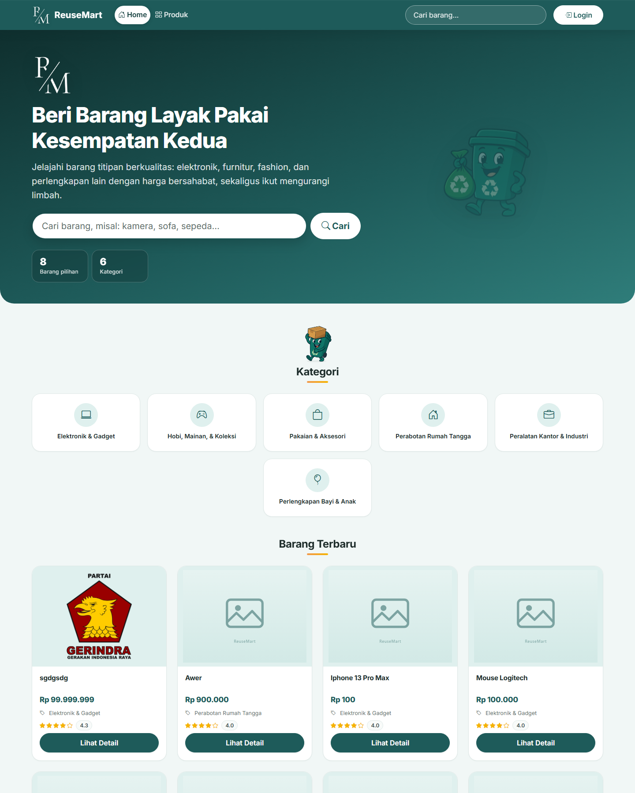
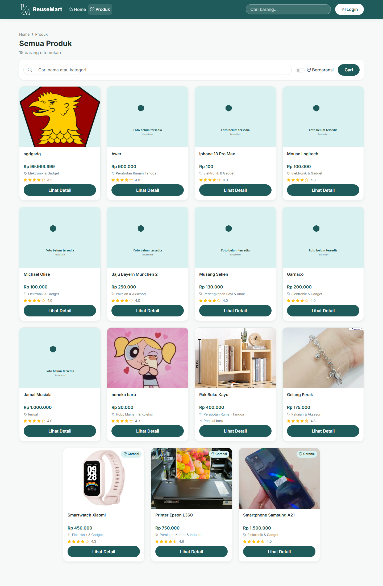
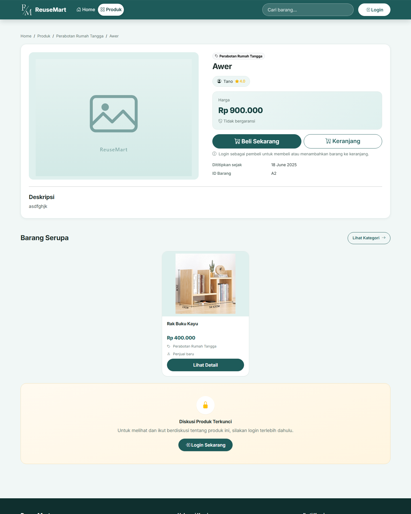
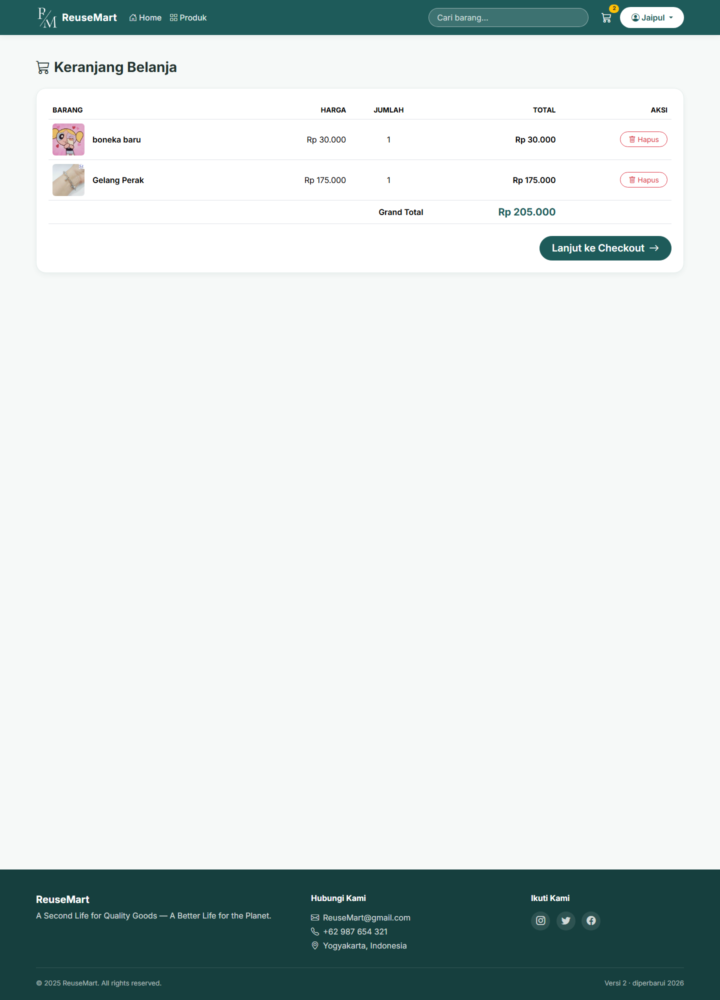

# ReuseMart Web

Marketplace barang bekas dan barang titipan, membawa barang layak pakai dari penitip ke pembeli yang membutuhkannya. Dibangun dengan Laravel 12 dan MySQL, serta dipakai bersama aplikasi mobile Flutter di [reusemart-mobile](https://github.com/Tano11933/reusemart-mobile).

## Fitur

**Pengunjung**
- Katalog barang tersedia dengan pencarian, filter garansi, kategori, dan halaman detail
- Foto produk, kondisi, masa garansi, dan profil penjual

**Pembeli**
- Keranjang, checkout dengan alamat pengiriman, dan pembayaran dengan unggah bukti transfer
- Riwayat pembelian dan penilaian barang
- Pembatalan transaksi, kelola alamat, profil, dan poin

**Penitip**
- Daftar barang titipan, perpanjangan masa penitipan, dan jadwal pengambilan
- Riwayat penjualan dan profil penitip

**Pegawai**
- Admin: data pegawai, jabatan, organisasi, dan merchandise
- Customer Service: data penitip, diskusi produk, verifikasi pembayaran, klaim merchandise, dan penukaran poin
- Gudang: inventaris barang, pengambilan titipan, pesanan diambil dan dikirim, nota pemesanan
- Owner: request dan riwayat donasi, laporan penjualan, komisi, stok, kategori, barang kedaluwarsa, serta transaksi penitip dalam bentuk PDF

**Organisasi**
- Dashboard request donasi: mengajukan, mengubah, dan memantau status permintaan

## Tampilan

| Beranda | Katalog |
|---|---|
|  |  |

| Detail barang | Keranjang |
|---|---|
|  |  |

Screenshot lain, termasuk sisi pegawai, ada di `docs/screenshots/after`. Versi Juni 2025 tersimpan di `docs/screenshots/before`.

## Teknologi

- Laravel 12, PHP 8.2+, MySQL
- Blade + Bootstrap 5 (dimuat dari CDN, tidak perlu build asset)
- barryvdh/laravel-dompdf untuk nota dan laporan PDF
- intervention/image untuk pengolahan gambar
- Tema dan komponen ada di `public/css/reusemart.css`; arah desain ada di `DESIGN.md`

## Menjalankan

```bash
composer install
copy .env.example .env
php artisan key:generate
```

Atur koneksi MySQL di `.env`, lalu:

```bash
php artisan migrate
php artisan serve
```

Catatan: migrasi bawaan Laravel tersedia. Skema tabel aplikasi (barang, pemesanan, dan seterusnya) belum dikemas sebagai migrasi, jadi untuk saat ini dibutuhkan dump basis data pengembangan. Pengemasan skema ke migrasi dan seeder adalah agenda berikutnya.

## Struktur

```
app/Http/Controllers     controller per domain (barang, pemesanan, penitip, donasi, laporan, ...)
app/Models               model Eloquent
resources/views          halaman Blade per peran
routes/web.php           route web dan sebagian endpoint API
routes/api.php           endpoint yang dipakai aplikasi mobile
public/css/reusemart.css tema dan komponen bersama
docs/screenshots         dokumentasi tampilan before dan after
```

## Kredit

Proyek kelompok mata kuliah P3L (2025), dikembangkan ulang dan dirapikan pada 2026 untuk portofolio. Repositori asli kelompok: [paniae/P3L_1829_1933_2024](https://github.com/paniae/P3L_1829_1933_2024).

Anggota tim: Tano11933, paniae.

## Changelog singkat

**v2 (2026)**
- Desain ulang seluruh halaman: layout, komponen, kontras, dan aksesibilitas keyboard
- Perbaikan route rusak dan duplikat, pengamanan akses alamat dan pembatalan pesanan
- Pembatasan akses per peran dan jabatan lewat middleware, plus pembatasan percobaan login
- Perbaikan bug halaman klaim merchandise CS dan endpoint barang penitip di aplikasi mobile
- Checkout menyimpan alamat pengiriman dan metode pembayaran
- Endpoint mobile dirapikan, termasuk login, token FCM, dan riwayat
- Dokumentasi: `DESIGN.md` dan screenshot before/after

**v1 (Juni 2025)**
- Versi awal proyek kelompok, tersimpan pada tag `v1.0-juni-2025`
